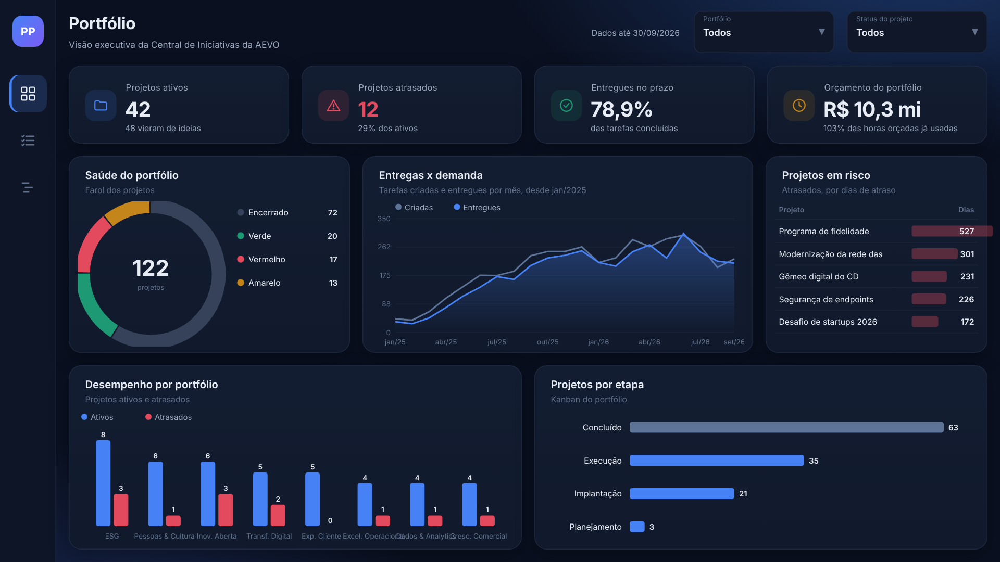
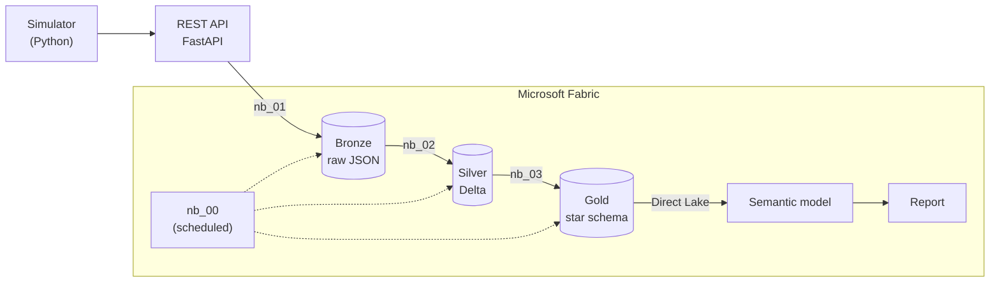
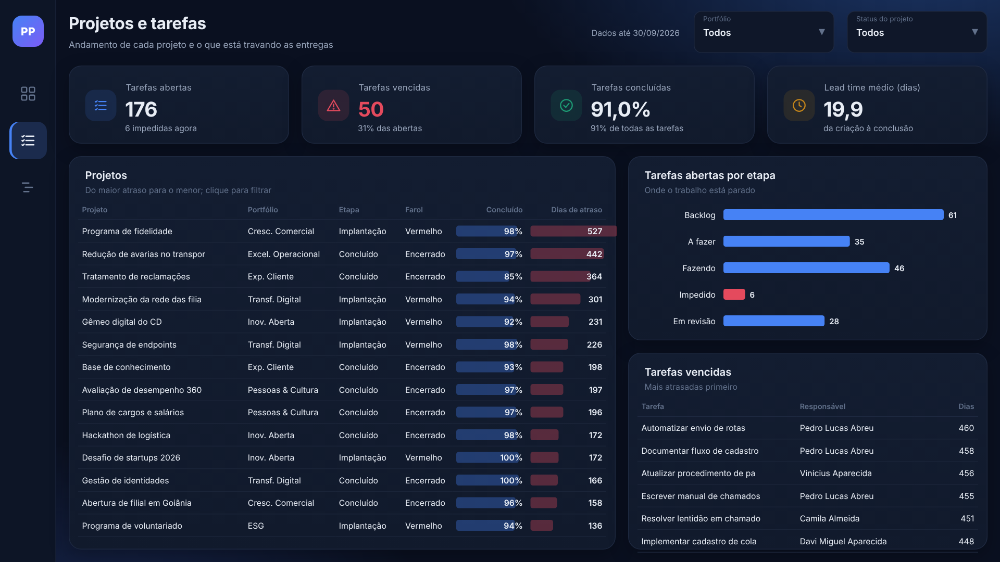
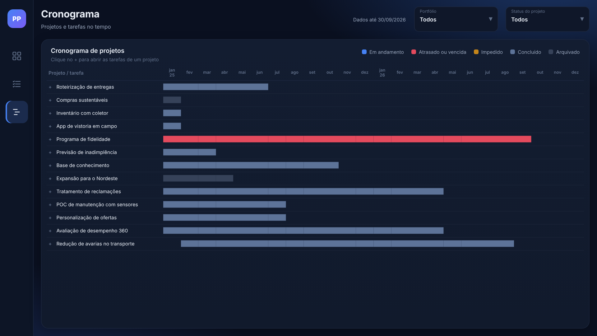

# Project Dashboard - API + Microsoft Fabric + Power BI

[](https://github.com/GuilhermeRostirolla/painel-projetos-fabric/actions/workflows/testes.yml)
[Versão em português](README.md)

Pipeline that pulls data from a project-management tool through an API, processes it in Microsoft Fabric (bronze, silver and gold) and delivers a Direct Lake semantic model with a 3-page executive Power BI report. The model and the report are generated from code and published by a notebook.

It follows the [Ideas Dashboard](https://github.com/GuilhermeRostirolla/painel-ideias-powerbi). There the data came from SQL Server; here it comes from an API shaped like AEVO's Central de Iniciativas (portfolios, projects, tasks and stage movements), so ingestion has to deal with tokens, pagination, incremental loads and rate limits.



## What the dashboard answers

- How healthy the portfolio is (green, yellow, red traffic light) and which stage each project is in
- Which projects are late, by how much and in which portfolio
- How much of the budget has been used and how many projects came from ideas
- How many tasks are overdue or blocked and how long they take from start to finish
- How projects and tasks are spread over time (Gantt)

## Data

The data is fictitious. Project and people-performance data is sensitive, so I built a simulated API that behaves like a real tool's (token, pagination, incremental filter and the occasional 429 response).

Field names follow AEVO's Central de Iniciativas: projects have a portfolio stage (Planejamento, Execução, Implantação, Concluído), a status (Ativo, Concluído, Arquivado), a traffic light, an origin (idea, startup or direct), a manager, a budget and labels such as "Em espera"; tasks move through the kanban Backlog, A fazer, Fazendo, Impedido, Em revisão, Concluído and Arquivada.

Behind the API, a Python simulator runs every task through that state machine, with impediments, rework and archiving. Each project has a "health" and a deadline promised by its manager, sometimes too optimistic.

Scenario on 2026-09-30: 8 portfolios, 122 projects, 147 people, 4,467 tasks and 24,424 movements since Jan/2024. 42 active projects, 12 late, 50 overdue tasks, R$ 10.3M in budget and 48 projects that started as ideas.

## Architecture



- **Bronze (`nb_01`)**: stores each API page as received, with a watermark per resource. The watermark only moves forward when every resource was written, so a failure halfway makes the next run repeat the window. 429 and 5xx responses are retried, honoring `Retry-After`. The token lives in Azure Key Vault.
- **Silver (`nb_02`)**: fixed schema per resource, standardized text and dates, one row per record. Records with an unknown status or an orphan key go to `silver_rejeitados` with the reason.
- **Gold (`nb_03`)**: `fato_tarefa`, `fato_passagem_status` and the dimensions. Cycle time, blocked time and rework come from the movement history. Everything is measured against the reference date stored in the data, not `TODAY()`, so the numbers don't change on their own.
- **Model (`PainelProjetos.SemanticModel`)**: Direct Lake, 7 tables, 54 measures and one RLS role per portfolio (8). The TMDL is generated by `tools/gerar_modelo.py` from the gold schema.
- **Report (`PainelProjetos.Report`)**: PBIR generated by `tools/gerar_relatorio.py`, on top of backgrounds designed in HTML (`tools/design`).
- **Publishing (`nb_04`)**: creates or updates the model and the report through the Fabric REST API, runs every measure in DAX and compares it with values calculated in SQL (`docs/valores_esperados.json`), and queries the model as each RLS role to check the filter.

## Pages

- **Portfolio**: executive view with traffic light, deliveries vs. demand, projects at risk, performance by portfolio and a stage kanban.
- **Projects and tasks**: progress of each project and where tasks are stuck.
- **Schedule**: project Gantt that drills down into tasks, colored by status.

| Projects and tasks | Schedule |
|---|---|
|  |  |

## Design

The report is built for executives: dark theme, four indicators per page with a context line ("29% of active projects", "103% of budgeted hours already used"), color only where it carries meaning (blue for volume, red for delays, amber for blockers, green for on-time delivery) and side navigation between the three pages.

Cards, icons and the grid live in one background image per page, rendered from HTML (`tools/design/mockup_redesign.py` and `renderizar_fundos.js`). The Power BI visuals are transparent and placed on the same grid (`tools/design/layout.py`), so the mockup and the report never drift apart. The full mockup is in [`docs/design/redesign.html`](docs/design/redesign.html).

## Tests

Tests and lint (`ruff`) run on GitHub Actions on every push and pull request.

- `pytest`: simulator, API, notebooks, model (every column and measure referenced in DAX exists) and report (every field exists, no overlapping visuals).
- `pytest -m pipeline`: runs the Fabric notebooks on local Spark and checks the gold layer against calculations made in Python straight from the API.
- Incremental load: a full load on 08/31 followed by an incremental load on 09/30, with 30% of API calls failing, produced the same gold as a single full load on 09/30.
- In Fabric, `nb_04` fails if any measure doesn't match the SQL value or if any RLS role can see another portfolio.

## Running it

Locally (Python 3.11+, Java 17+ for Spark):

```bash
pip install -r requirements-dev.txt
pytest
python tools/rodar_local.py --limpar
uvicorn api.app:criar_app --factory    # http://127.0.0.1:8000/docs, token: token-demo
```

`rodar_local.py` runs the notebooks in `fabric/` unchanged, writing Parquet.

In Fabric:

1. Deploy the API (`render.yaml` deploys it to Render) and store the token in Key Vault as `token-api-projetos`.
2. Create a workspace with a lakehouse named `lh_projetos`.
3. Import the notebooks in one of two ways:
   - **Manually (no downloaded code is executed):** in the workspace, use **Import > Notebook > From this computer** with the files in `fabric/ipynb/` and set `lh_projetos` as the default lakehouse of each one.
   - **With the script:** `tools/instalar_no_fabric.py` creates or updates the five notebooks through the Fabric API and attaches the lakehouse. Read the script and pin the commit you reviewed, so you don't run a different version from the one you read:
     ```python
     COMMIT = "<full-commit-sha>"
     RAMO = COMMIT
     import requests; exec(requests.get(f"https://raw.githubusercontent.com/GuilhermeRostirolla/painel-projetos-fabric/{COMMIT}/tools/instalar_no_fabric.py").text)
     ```
4. Run `nb_00_orquestrador` with `MODO = "completo"`, filling in `URL_API` and `KEY_VAULT_URL`.
5. Run `nb_04_publicar_modelo`.
6. Switch `MODO` back to `incremental` and schedule `nb_00`.

To test without deploying the API, `tools/testar_no_fabric.py` starts the API inside the Fabric session itself and runs the orchestrator against it.

## Issues found in Fabric

- The runtime uses Python 3.11 and numpy 2.5 requires 3.12. I pinned numpy 2.4.6, and the API exposes a hash of the scenario (`/v1/meta`) to confirm the data matches the tests.
- Direct Lake rejects relationships with `joinOnDateBehavior`. The gold layer stores dates without time and the model uses plain equality.
- A notebook can only call another one if both share the same default lakehouse (or use `useRootDefaultLakehouse`).
- Installing packages in the session broke libraries Fabric had already loaded; the test API runs in a separate process.
- Right after the tables were created, the SQL endpoint couldn't see them yet and the model refresh failed. Opening the endpoint and running again fixed it.
- The trial capacity allows only a few concurrent Spark sessions; a forgotten open session causes error 430.
- raw.githubusercontent.com caches `main` for a few minutes. The installer and `nb_04` resolve the branch to the commit SHA before downloading files.

## Structure

```
api/          FastAPI API
simulador/    catalogs, state machine, scenario and validation
fabric/       notebooks (Fabric Git format), semantic model and report
fabric/ipynb/ the same notebooks as .ipynb
tools/        model and report generators, local run, Fabric installation
docs/         expected measure values, screenshots and design
tests/
```

## License

[MIT](LICENSE)
